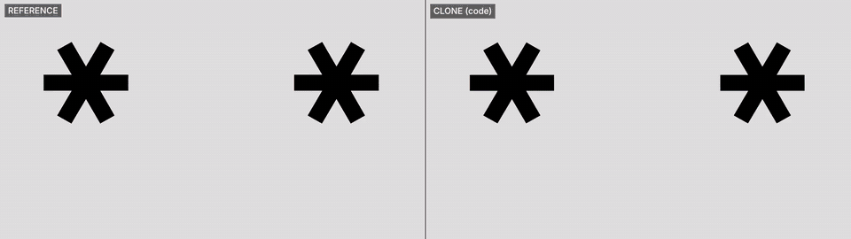

# openai-get-ready-clone

Reverse-engineering finished motion-graphics videos **frame by frame** and rebuilding them as **pure code**: every shape, glyph and dot is a live vector layer drawn on a canvas, driven by measured data and recovered easing formulas. No footage, no tracing overlays, and no frames copied from the source.

## 01 · OpenAI "Get ready" (DevDay 2026 teaser) → [`openai-get-ready/`](openai-get-ready/)

| | |
|---|---|
| Output | 2560×1440 · 60 fps · 12.1 s · 726 frames |
| Match (whole video, 360p gray) | **MAD 0.18 / 255 · SSIM 0.998** |
| Clone-only pops | **0** |
| Stack | Canvas2D + headless Chromium + ffmpeg; Python (OpenCV, SciPy, potrace) for measurement |

**How it was rebuilt**
- **Faces:** 6 coloured discs measured with sub-pixel contours and RANSAC circle fits. Each eye glyph (`* > < ^ + o -`) gets a per-frame affine fit with ECC, which recreates the "eyes wrap around the sphere" effect.
- **Dots:** each dot is fitted as a disc after chroma unmixing. Clusters of touching dots are separated with a blurred union-of-discs least-squares fit and BIC model selection.
- **Typography:** the font is proprietary and matched none of 27 open fonts, so the glyphs were **vectorised from the video itself**. Each glyph's state per frame (hidden / outline with alpha / filled) comes from model comparison.
- **Camera:** a per-frame similarity transform. The zoom-out in the "20+ launches" shot is exactly one CSS curve, `cubic-bezier(0.029, 0.642, 0.376, 1.108)` (rms 7·10⁻⁵).

Full write-up: [`REPORT.md`](openai-get-ready/REPORT.md) · run it yourself: [`HOWTO.md`](openai-get-ready/HOWTO.md)

Media: [`clone_2k60.mp4`](openai-get-ready/media/clone_2k60.mp4) · [`compare_ref_vs_clone.mp4`](openai-get-ready/media/compare_ref_vs_clone.mp4)

---
*This is a technical study for education and demonstration. "OpenAI", "DevDay" and the original video, music and typeface belong to their owners. This repo is not affiliated with OpenAI. The reference video itself is not included.*
